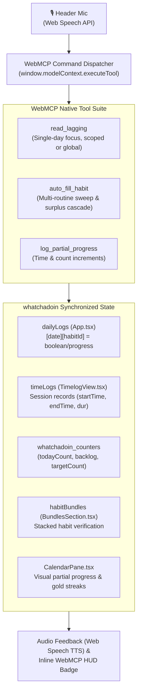
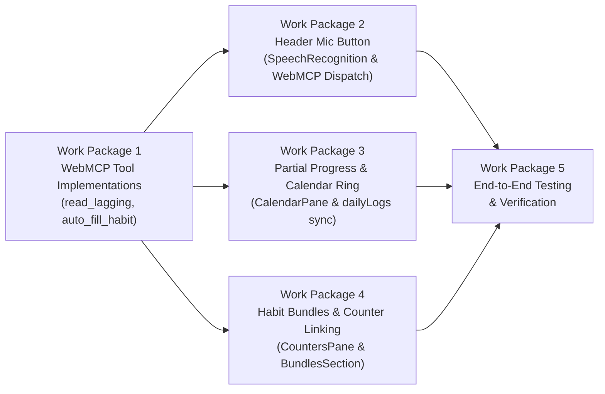

# WebMCP Voice & Habit Backfill Engine Specification

> **Status:** Approved Architecture Plan  
> **Target:** 100% WebMCP-Native (No proprietary/native AI backend dependencies)  
> **Key Protocols:** Web Model Context Protocol (`modelContext`), Web Speech API (`SpeechRecognition`, `SpeechSynthesis`), Reactive Event Sync  

---

## 1. System Vision & Architecture

This specification defines the integration of a voice-driven habit, routine, and backlog management engine into **whatchadoin**. The system operates directly through **WebMCP** (`window.modelContext`), enabling browser-native speech recognition to trigger deterministic tools, calculate scoped lags, auto-fill multi-day habit streaks, and synchronize partial progress across calendars, time logs, and counters.

---

## 2. Core Functional Requirements

### A. WebMCP Header Mic Button
- **Location:** Embedded in [`Header.tsx`](../src/components/Header.tsx) alongside Dispatch and Wallet controls.
- **Protocol:** Pure WebMCP. Calls `(window as any).modelContext.executeTool(name, args)` directly.
- **Behavior:**
  1. Click mic to listen via `webkitSpeechRecognition` / `SpeechRecognition`.
  2. Pulse animation while listening (`syncPulse` / glowing ring).
  3. Dispatches recognized speech to WebMCP tools.
  4. Returns audio confirmation using browser `speechSynthesis` and renders a status toast.

### B. Scoped "What's Lagging?" Query Engine (`read_lagging`)
- **Single-Day Focus Rule:** Instead of overwhelming the user with a 10-day list, it reports **only the oldest uncompleted date** and its required duration.
- **Global Scope vs. Habit Scope:**
  - **Global (`"What's lagging?"`):** Scans all habits from routine `start` date to today. If October 13th is the oldest date with any incomplete habit, returns:
    > *"You have 15 minutes to be done on 13th October."*
  - **Habit-Scoped (`"What's lagging in Calisthenics?"`):** Filters only for Calisthenics. If Calisthenics is already complete on October 13th, it automatically skips to the 14th:
    > *"You have 15 minutes of Calisthenics to be done on 14th October."*
- **Multi-Routine Support:** Checks habits across all routines (`routines` array), labeling routines cleanly (e.g. `[100DREAM]` vs `[Vanilla]`) and defaulting to the active routine.

### C. Multi-Routine Habit Auto-Fill & Surplus Cascading (`auto_fill_habit`)
- **Fuzzy-Match Global Sweep:** Matches queries like *"I did 20 mins of walking"* to habits across all routines (e.g., `Walk Pic x10K`).
- **Oldest-First Backfill:** Chronologically fills missed days starting from the oldest uncompleted date up to today.
- **Surplus Cascading:**
  - Example: Target is 15 minutes for Calisthenics; user logs 2 hours (120 minutes).
  - 15m completes today $\rightarrow$ Remaining 105m backfills previous unlogged days $\rightarrow$ Extra surplus banks into future streak buffers or milestone quotas without double-counting.

### D. Partial Progress Logging & Cross-Module Sync
- **Example:** Target is 15 minutes (or 3 questions) of DSA; user logs 10 minutes.
  1. **Time Logs:** Adds a 10-minute session block in [`TimelogView.tsx`](../src/components/habits/TimelogView.tsx) tagged to DSA.
  2. **Habits Pane:** Shows 10m / 15m logged, status remains *In Progress*, informs user: *"5 minutes remaining"*.
  3. **Counters:** Advances `todayCount` in [`CountersPane.tsx`](../src/components/CountersPane.tsx) (+1 question).
  4. **Calendar:** Renders a partial progress ring/badge in [`CalendarPane.tsx`](../src/components/CalendarPane.tsx) instead of binary 0% or 100%.

### E. Habit Bundles Verification
- When any habit belonging to a bundle (e.g. `habitBundles`) completes or backfills, the bundle automatically checks whether sister habits are complete and updates the bundle's completion state in [`BundlesSection.tsx`](../src/components/habits/BundlesSection.tsx).

---

## 3. Subagent Work Packages (Decomposition)

To implement this modularly and reliably, the work is divided into 5 independent work packages suitable for subagents:

### Work Package 1: WebMCP Tool Suite Implementation
- **Files:** `src/features/ai/toolDefinitions.ts`, `src/hooks/useWebMCPIntegration.ts`
- **Tasks:**
  1. Register `read_lagging`:
     - Inputs: `habitName?: string`, `routineId?: string`, `scope?: 'global' | 'habit'`.
     - Output: `{ oldestDate, habitName, routineName, durationMinutes, remainingTasksCount, message }`.
  2. Register `auto_fill_habit`:
     - Inputs: `habitName: string`, `durationMinutes: number`, `cascade?: boolean`.
     - Output: `{ routineName, habitName, filledDates: string[], surplusMinutesRemaining, message }`.
  3. Register `log_partial_progress`:
     - Inputs: `habitName: string`, `progressAmount: number`, `unit: 'minutes' | 'count'`.
     - Output: `{ logged, target, remaining, completed, message }`.

### Work Package 2: Header Mic Button & Voice Dispatcher
- **Files:** `src/components/Header.tsx`
- **Tasks:**
  1. Add a microphone icon button in `header-controls` with listening states (`idle`, `listening`, `processing`).
  2. Initialize `webkitSpeechRecognition` / `SpeechRecognition` on click.
  3. Simple intent parser that maps voice queries directly to WebMCP tools:
     - *"What's lagging?"* $\rightarrow$ `modelContext.executeTool('read_lagging', { scope: 'global' })`
     - *"What's lagging in [habit]?"* $\rightarrow$ `modelContext.executeTool('read_lagging', { habitName: '[habit]' })`
     - *"I did [X] mins of [habit]"* $\rightarrow$ `modelContext.executeTool('auto_fill_habit', { habitName: '[habit]', durationMinutes: X })`
  4. Audio output response via `window.speechSynthesis`.

### Work Package 3: Calendar Partial Progress & Visual Fill
- **Files:** `src/components/CalendarPane.tsx`
- **Tasks:**
  1. Calculate fractional day completion (`completedHabits / totalHabitsForDay`).
  2. Support partial progress indicators:
     - Full completion: Solid gold fill (`var(--accent)`).
     - Partial completion: Accent border with subtle radial/conic gradient or progress ring reflecting exact percentage.
     - Today in-progress: Distinctive pulse border.

### Work Package 4: Counter & Habit Bundle Synchronization
- **Files:** `src/components/CountersPane.tsx`, `src/components/habits/BundlesSection.tsx`
- **Tasks:**
  1. Connect `auto_fill_habit` and `log_partial_progress` to trigger `'whatchadoin_counters_updated'`.
  2. Auto-decrement counter backlogs when habits or reps are logged.
  3. Check and update `habitBundles` status whenever child habits are marked complete.

### Work Package 5: Build, Test & Lint Validation
- **Tasks:**
  1. Run TypeScript check (`tsc -b`).
  2. Run Vite build verification (`npm run build`).
  3. Verify WebMCP declarative registry in DOM (`#webmcp-declarative-registry`).
  4. Test edge cases: 10-day backlog jump, duplicate habit in 2 routines, 2-hour surplus cascade.
