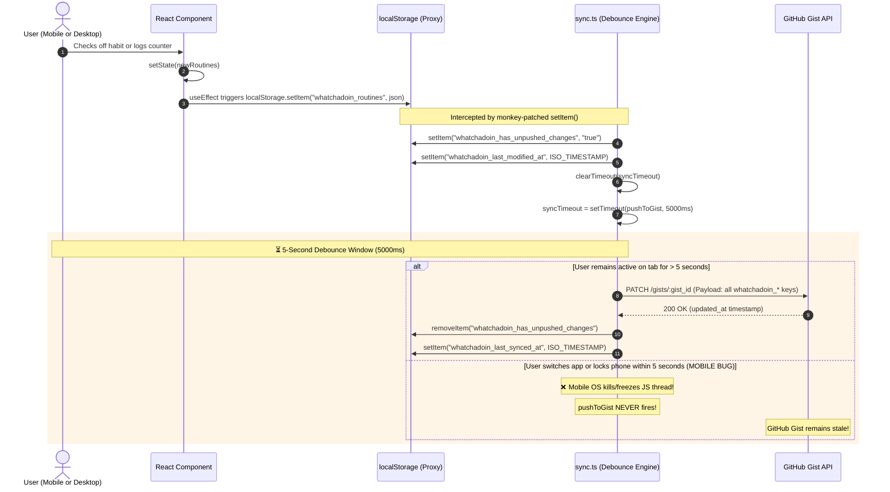
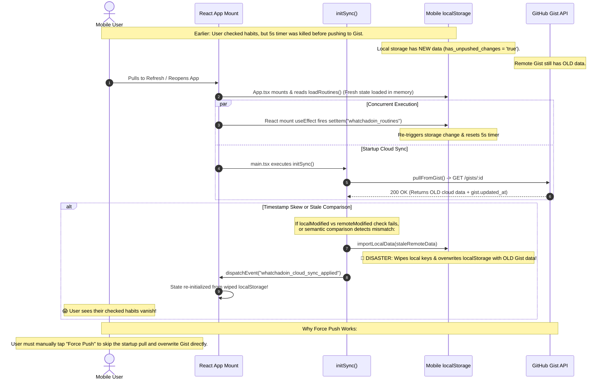
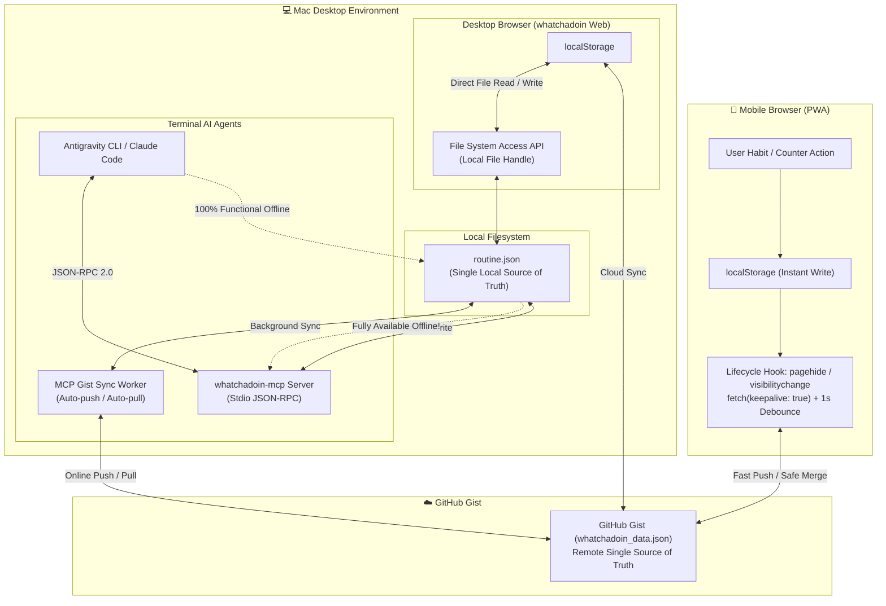
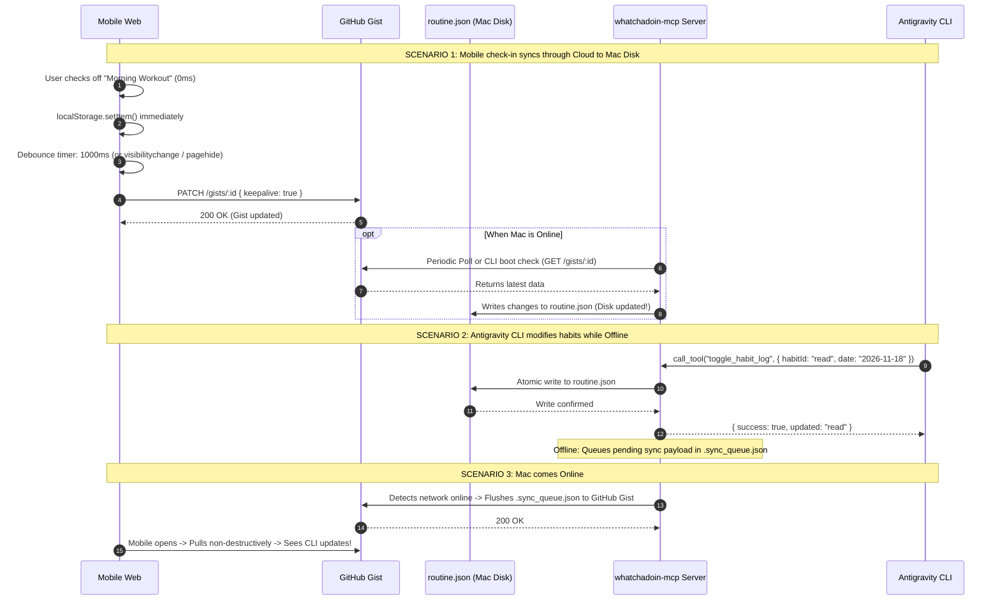

# whatchadoin Data Flow & Synchronization Architecture

> **Document Version:** 1.0.0  
> **Target Systems:** Mobile Safari / Chrome (iOS/Android), Desktop Web (macOS/Chrome/Safari), Antigravity CLI & Claude Code (Local MCP Server), GitHub Gists (Cloud Backup), Local Disk (`routine.json`)  
> **Status:** Architecture Audit, Flaw Analysis & Unification Plan  

---

## 1. Executive Summary

**whatchadoin** operates across multiple environments:
1. **Mobile Web (PWA / Browser):** Fast on-the-go habit check-ins, counter increments, and task ticks.
2. **Desktop Web:** Full planning, timeline drag-and-drop, routine editing, and WebMCP voice commands.
3. **Terminal AI (Antigravity CLI & Claude Code):** Autonomous agents interacting via Model Context Protocol (MCP) to query lags, schedule blocks, log progress, and perform daily summaries.

Currently, these environments suffer from severe data fragmentation, mobile sync suspension, refresh-wipe race conditions, and disconnection between terminal AI agents and the cloud/mobile state.

This document details:
- **Existing Architecture:** How data flows today, including the exact debounce intervals and storage proxies.
- **Flaws & Mobile Pain Points:** Why mobile browser timer throttling kills sync, why changes vanish on reload, and why Antigravity CLI on Mac is isolated from the rest of the app.
- **Improvements & Unified Architecture:** The solution introducing a local file bridge, mobile lifecycle hooks, schema unification, and conflict-free two-way synchronization.

---

## 2. Existing Data Flow Architecture (As-Is)

Currently, the application relies on two disconnected silos:
- **Silo A (Web & Mobile):** Browser React state $\leftrightarrow$ `localStorage` $\leftrightarrow$ GitHub Gist.
- **Silo B (Terminal AI):** Antigravity CLI / Claude Code $\leftrightarrow$ Local MCP Server $\leftrightarrow$ `routine.json` (Local Disk).

### 2.1 Existing Architecture Map

```mermaid
flowchart TD
    subgraph MobileDevice ["📱 Mobile (Safari / Chrome)"]
        MobileUI["Mobile UI Actions\n(Toggle habit, count, task)"]
        MobileReact["React State (App.tsx)"]
        MobileLS["Browser localStorage\n(whatchadoin_* keys)"]
        MobileTimer["Debounce Timer\n(setTimeout 5000ms)"]
    end

    subgraph DesktopMac ["💻 Desktop Mac (Browser)"]
        MacUI["Desktop UI Actions\n& WebMCP Voice Mic"]
        MacReact["React State (App.tsx)"]
        MacLS["Browser localStorage\n(whatchadoin_* keys)"]
        MacTimer["Debounce Timer\n(setTimeout 5000ms)"]
    end

    subgraph CloudStorage ["☁️ Remote GitHub Gist"]
        Gist["GitHub Gist API\n(whatchadoin_data.json)\nFlat Key-Value Dict"]
    end

    subgraph TerminalAgent ["🤖 Terminal AI (Mac)"]
        Antigravity["Antigravity CLI / Claude Code"]
        MCPServer["whatchadoin-mcp Server\n(Node.js stdio JSON-RPC)"]
        RoutineJSON["routine.json\n(Static Local File on Disk)"]
    end

    %% Mobile Data Flow
    MobileUI --> MobileReact
    MobileReact -->|useEffect| MobileLS
    MobileLS -->|Monkey-patched setItem| MobileTimer
    MobileTimer -.->|"5s wait (Often killed!)"| Gist

    %% Mac Web Data Flow
    MacUI --> MacReact
    MacReact -->|useEffect| MacLS
    MacLS -->|Monkey-patched setItem| MacTimer
    MacTimer -->|PATCH /gists/:id (5s)| Gist
    Gist -.->|"GET /gists/:id (on startup)"| MacLS
    Gist -.->|"GET /gists/:id (on startup)"| MobileLS

    %% Terminal Agent Isolated Flow
    Antigravity <-->|stdio JSON-RPC 2.0| MCPServer
    MCPServer <-->|Atomic fs.readFileSync / writeFileSync| RoutineJSON

    %% Disconnection Highlights
    RoutineJSON x-.-x|"NO SYNC (Isolated Silo)"| Gist
    RoutineJSON x-.-x|"NO ACCESS (Sandbox Barrier)"| MacLS
    MCPServer x-.-x|"NO ACCESS (Browser Context Only)"| MobileLS
```

---

### 2.2 Chronological Timing & Interval Sequence

The following sequence illustrates what occurs under the hood from the moment a user interacts with the app to the GitHub cloud push:



---

## 3. Analysis of Critical Flaws & Pain Points

### Pain Point 1: Mobile Timer Killing (`setTimeout` 5000ms)
- **Mechanism:** In mobile browsers (iOS WebKit / Safari, Chrome on Android/iOS), power management prioritizes battery life. When a user switches to another app, closes the browser, or locks the phone, background timers (`setTimeout`, `setInterval`) are either throttled to 1 run/minute or completely frozen immediately.
- **Consequence:** 
  - A user opens whatchadoin on their phone, checks off their morning habits (taking ~3 seconds), and immediately locks their phone.
  - The 5-second timer (`setTimeout(..., 5000)`) is suspended in memory.
  - The scheduled `pushToGist()` is never dispatched.
  - The cloud (GitHub Gist) never receives the update.

---

### Pain Point 2: "Are Changes Stored in Local Storage?" (The Truth)
- **Answer:** **Yes, initially.**
- `localStorage.setItem` is called synchronously inside React's `useEffect`.
- `whatchadoin_routines`, `whatchadoin_counters`, etc., are written to disk storage in the browser sandbox.
- However, the metadata flags `whatchadoin_has_unpushed_changes` and `whatchadoin_last_modified_at` are also written.

---

### Pain Point 3: Why Changes Vanish on Refresh (The Overwrite Disaster)
If changes were stored in `localStorage`, why do they vanish when refreshing the mobile browser?

Here is the exact step-by-step race condition:



#### Root Causes of the Overwrite:
1. **Initial Mount Mutation Storm:** When `App.tsx` mounts, multiple `useEffect` hooks run (`routines`, `milestones`, `lifeGoals`, `moneyGoals`). These immediately call `localStorage.setItem`, resetting `whatchadoin_last_modified_at` to *now* and queueing another 5-second debounce.
2. **`initSync` Pull vs Local State:** While the initial mount is firing, `initSync()` fetches remote Gist data. If GitHub Gist's `updated_at` or local flags have any timing discrepancies, `importLocalData` runs.
3. **Destructive Import:** `importLocalData` calls `localStorage.removeItem` for missing keys and overwrites existing keys with remote values without doing a 3-way merge. The fresh offline mobile edits are eradicated.

---

### Pain Point 4: Antigravity CLI / Mac Disconnection
Why can't Antigravity CLI connect to whatchadoin on macOS?

| Issue | Technical Reason | Current State |
| :--- | :--- | :--- |
| **Cannot access WebMCP** | WebMCP (`window.navigator.modelContext`) is an in-browser JavaScript API. It only exists inside a running browser window. | Antigravity CLI runs in the macOS Terminal (`zsh`), having no direct IPC or DOM bridge to the browser's `localStorage` or `window`. |
| **Cannot access Local MCP properly** | `whatchadoin-mcp` is hardwired to read and write `/routine.json` on disk. | The web app and mobile phone **never write to `routine.json`**! They only write to `localStorage` and GitHub Gist. |
| **Offline Failure** | If you are offline, Antigravity CLI cannot fetch from GitHub Gist, and the local `routine.json` is weeks out of date. | The CLI AI interacts with stale, deprecated habit data. |
| **Dual Schema Fragmentation** | Cloud Gist stores flat stringified key-values (`whatchadoin_routines: "[...]"`). Local `routine.json` stores nested structured objects (`routines: [...]`). | No adapter bridges the two formats automatically. |

---

## 4. Proposed Unified Architecture (To-Be)

To solve these problems permanently, we introduce the **Unified Local File & Cloud Sync Bridge**.

### Key Architectural Pillars:
1. **`routine.json` as the Single Canonical File on Disk:** 
   Both the Local MCP server (Antigravity CLI) and the Web App share `routine.json`.
2. **File System Access API (Desktop):**
   Desktop Chrome/Edge/Safari can bind directly to the local `routine.json` via the native File System Access API.
3. **MCP Cloud Sync Daemon:**
   The `whatchadoin-mcp` server gains direct GitHub Gist sync capabilities. When the CLI agent makes changes, it writes to `routine.json` **and** pushes to GitHub Gist asynchronously. When it boots, it pulls from Gist if online.
4. **Mobile Lifecycle Flushing (`keepalive: true` + 1000ms Debounce):**
   Shorten the mobile debounce from 5000ms to 1000ms. On `visibilitychange` (`hidden`) and `pagehide`, immediately flush pending data using `fetch(..., { keepalive: true })`.
5. **Non-Destructive Conflict-Free Merge (Never Wipe on Refresh):**
   `initSync` checks dirty flags before pulling. If local has unpushed edits, it pushes first or performs an entity-level merge (Last-Write-Wins per habit/counter) rather than wiping the entire database.

---

### 4.1 Unified System Flowchart



---

### 4.2 Detailed Unified Sync Protocol



---

## 5. Comparison: Existing vs. Improved Architecture

| Dimension | Existing Architecture (Flawed) | Improved Architecture (Unified) |
| :--- | :--- | :--- |
| **Sync Debounce Interval** | `5000ms` fixed timeout (prone to mobile suspension) | `1000ms` on mobile + immediate flush on `visibilitychange` & `pagehide` |
| **Mobile Unload / Background** | Regular `fetch` fails when tab is suspended or killed | `fetch(url, { keepalive: true })` ensures packet delivery after tab closure |
| **Startup Behavior** | Unconditional remote pull risks wiping unsynced local changes | Safe 3-way merge; never overwrites dirty local keys with older remote state |
| **Antigravity CLI Access** | Isolated to static `routine.json` (weeks stale, no cloud link) | MCP server syncs `routine.json` bidirectionally with GitHub Gist |
| **Offline Capability** | CLI and Web can't sync; CLI uses stale file, web uses local storage | Local `routine.json` is canonical; queue syncs to Gist once network is restored |
| **Data Format** | Key-Value string map (Gist) vs. Structured JSON (`routine.json`) | Unified Bidirectional Serializer bridges both schemas losslessly |
| **Manual Force Push** | Required constantly on mobile to prevent data loss | Only an emergency fallback; normal auto-sync is robust and race-free |

---

## 6. Implementation Action Plan

### Phase 1: Fix Mobile Sync Immediately in `src/sync.ts`
1. **Reduce debounce interval:** Reduce `5000ms` debounce to `1200ms` for mobile devices (detected via `navigator.userAgent`).
2. **Add `keepalive: true` to fetch:** Ensure all GitHub Gist `PATCH` and `POST` calls include `{ keepalive: true }` so mobile browsers do not drop HTTP requests when navigating away.
3. **Lifecycle flush listeners:**
   ```typescript
   const flushSync = () => {
       if (localStorage.getItem('whatchadoin_has_unpushed_changes') === 'true') {
           pushToGist(true);
       }
   };
   window.addEventListener('visibilitychange', () => {
       if (document.visibilityState === 'hidden') flushSync();
   });
   window.addEventListener('pagehide', flushSync);
   window.addEventListener('beforeunload', flushSync);
   ```
4. **Non-destructive startup check:** In `initSync()`, never call `importLocalData()` if `has_unpushed_changes === 'true'`. Always push local changes up first.

### Phase 2: Add GitHub Gist Sync to `mcp-server`
1. In `mcp-server/store.ts`, read GitHub credentials from environment variables (`WHATCHADOIN_GIST_TOKEN`, `WHATCHADOIN_GIST_ID`) or `.mcp.json`.
2. Add `syncWithGist()` to the MCP server store:
   - On server startup: Fetch Gist, compare `updated_at`, update `routine.json` if remote is newer.
   - On tool write (`save()`): Write to `routine.json` and push to GitHub Gist.

### Phase 3: Desktop Local File Bridge (File System Access API)
1. Add an optional "Link Local File" option in `SettingsModal.tsx` using `window.showOpenFilePicker()`.
2. Allow Mac desktop users to bind whatchadoin directly to `/Users/.../routine.json`, giving zero-latency local file editing that reflects instantly in Antigravity CLI.
